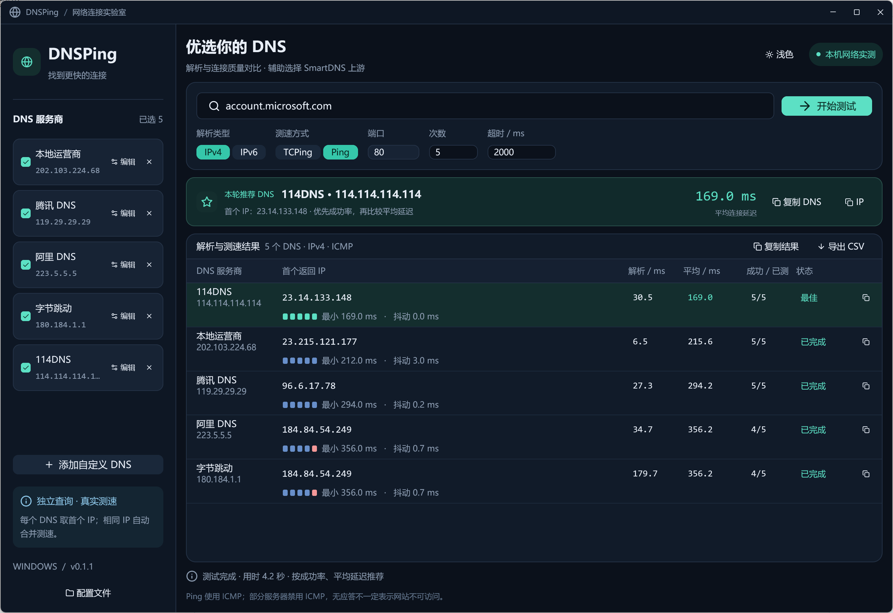

# DNSPing

Windows DNS 对比测速工具，基于 Rust + GPUI，辅助选择 SmartDNS 上游。



## 使用

从 [Releases](https://github.com/charley008/dnsping-rs/releases/latest) 下载 `DNSPing-windows-x64.zip`，解压运行 `DNSPing.exe`。选择 DNS、输入域名，点击「开始测试」。

- 支持 IPv4 / IPv6、Ping（ICMP）和 TCPing，按成功率和平均延迟推荐 IP。
- 支持添加、编辑、删除 DNS，复制结果和导出 CSV。
- 支持深色 / 浅色主题，无需安装，不修改系统 DNS。

默认查询 `account.microsoft.com`，使用 IPv4、ICMP，测试 5 次，超时 2000 ms。

| 内置 DNS | 地址 |
| --- | --- |
| 本地运营商 | 202.103.224.68 |
| 腾讯 DNS | 119.29.29.29 |
| 阿里 DNS | 223.5.5.5 |
| 字节跳动 | 180.184.1.1 |
| 114DNS | 114.114.114.114 |

配置保存在程序同目录的 `settings.json`，可关闭程序后手动编辑，格式参考 [配置示例](settings.example.json)。**升级时仍建议保留原有 `settings.json`。** v0.1.2 起会为每个程序目录保存升级保护副本，恢复被发行包默认配置覆盖的个人设置；从更早版本首次升级时请先备份配置。

## 构建

需要 Windows x64、Rust MSVC 工具链（版本由 `rust-toolchain.toml` 固定），以及 Visual Studio C++ Build Tools 和 Windows SDK。

```powershell
cargo run --locked --bin dnsping
cargo test --locked --all-targets
./scripts/package.ps1
```

发行包生成于 `dist/`。

## 许可

[MIT License](LICENSE)。通过 Codex（GPT-6.1 SOL）辅助开发。
