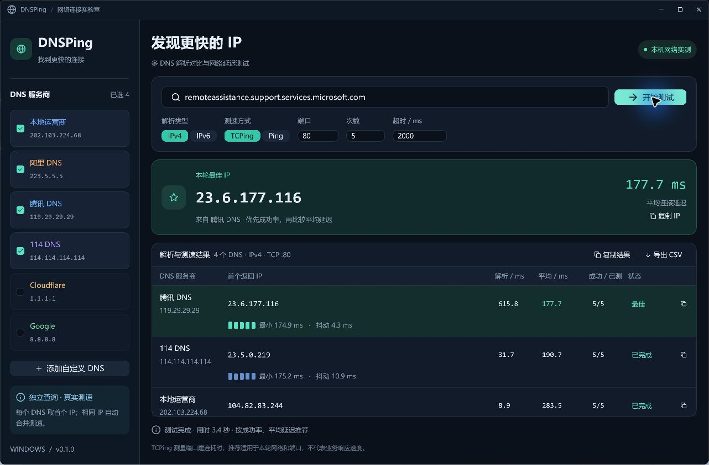

# DNSPing · Windows 架构与实现计划

## 产品目标

输入一个域名，向多个指定 DNS 服务器分别查询，保留每个响应中第一个有效的 A / AAAA 地址，然后对不同 IP 做多次 TCP / ICMP 测速。优先比较成功率，再比较成功样本的平均延迟，给出当前网络、当前协议与端口下的推荐 IP。DNS 时间单独展示，不参与延迟相加。

仅交付 Windows x64 桌面应用。Rust + GPUI 0.2.2 + GPUI Component 0.5.1 固定为经过适配的一组版本，Cargo.lock 随源码提交。GPUI 在 Windows 上使用 GPU 渲染和系统文本服务；应用不嵌入浏览器。

## 界面设计

- 深蓝黑工作台、青绿色强调色、细边框、圆角卡片；中文使用 Microsoft YaHei UI，IP / 数字使用等宽字体。
- 左侧约 252 px：品牌、DNS 服务商列表、勾选状态、添加 / 删除自定义服务器。
- 主区：标题和网络状态 → 域名输入及开始按钮 → 查询类型、测速方式、端口、次数、超时 → 推荐卡片 → 实时结果表格。
- 首次打开显示真实的空状态，不伪造测试数据。进行中逐行更新，失败原因明确显示。
- 可复制推荐 IP、复制单行 IP、复制完整结果、导出 CSV。已完成结果保留到下一轮开始。
- 最小窗口 1080 × 720，默认至多 1280 × 880，并根据屏幕尺寸留出边缘空间；表格独立滚动，IPv6 列溢出时省略并可复制完整值。

## 模块与依赖方向

```text
main → ui → engine → dns
             ↓        probe → Windows ICMP API / Tokio TCP
           model
ui → config → model
```

- `model.rs`：配置、查询类型、测速类型、解析结果、样本、统计、排序。纯数据与可测试规则。
- `config.rs`：从 %LOCALAPPDATA%/DNSPing/settings.json 加载；临时文件 + 重命名保存；损坏配置提示并回退默认值。
- `dns.rs`：Hickory 负责 DNS 报文编解码；直接访问用户选定的服务器，不经过系统 DNS 缓存。UDP 查询，截断则 TCP 重试；检查 ID、问题、响应码；仅取对应名称 / CNAME 链上的首个匹配记录，必要时继续向同一 DNS 查询 CNAME 目标。整个解析受超时限制。
- `probe.rs`：TCP 使用 connect + timeout；ICMP 调用 Windows IcmpSendEcho / Icmp6SendEcho2，无需解析不同语言的 ping.exe 输出。耗时取响应 RTT，失败不记作 0 ms。
- `engine.rs`：Tokio 多线程运行时；DNS 并发查询；DNS 阶段完成后按 IP 去重并发测速、串行采样。通过通道传递行状态。CancellationToken 取消异步工作，ICMP 阻塞调用也由有限超时约束。
- `ui.rs`：GPUI 主线程拥有视图状态；后台不接触 UI。使用运行编号和独立通道隔离历史任务；定时消费进度，保留原始 DNS 行及地址顺序。

## 行为约定

- 默认勾选 202.103.224.68、223.5.5.5、119.29.29.29、114.114.114.114；另外提供 Cloudflare、Google 供选。
- 默认 A / IPv4、TCP、80 端口、5 次、每次 2000 ms。ICMP 模式下端口不参与测试。
- 接受纯域名，包括 IDN 和末尾点；URL、端口和路径明确拒绝。自定义 DNS 接受 IPv4 或 IPv6 地址，固定 53 端口。
- 推荐仅在整轮完成后确定；全失败、取消或仍在执行时不会把部分结果标成最终推荐。
- 同 IP 使用同一组样本。成功率相同则平均延迟低者优先，再按原 DNS 顺序稳定排序。
- TCP 成功只表示该 IP 的端口可建立连接；不代表 HTTPS 证书、SNI 或业务响应验证。ICMP 失败单独说明可能被禁用。
- 不修改系统 DNS、hosts 或网络设置；不自动发起测试。

## 分步实施与验收

1. 架构及界面规范；确认本机工具链，固定依赖。
2. 数据模型、输入验证、DNS 协议、TCP / ICMP 和调度；本地模拟 DNS / TCP、排序及取消测试。
3. 完整 GPUI 界面：输入、选择、实时结果、取消、复制、导出和持久化。
4. Windows 编译，真实域名查询与测速冒烟测试，截图检查布局与中文显示。
5. 格式 / clippy / tests，生成 Release exe，交付使用说明与已知限制。

## 已实现的 Windows 界面

以下为最终 Release 程序对用户示例域名实际测速后的截图：


